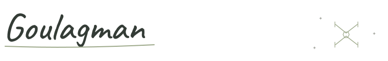
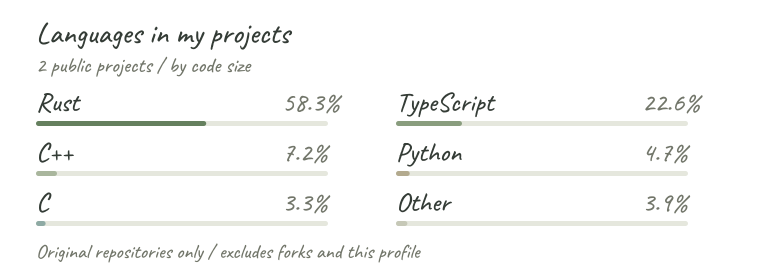

<picture>
  <source media="(prefers-color-scheme: dark)" srcset="assets/name-dark.svg" />
  
</picture>

**Mechanical engineering student, France.** Open source, music, and a bit of tinkering.

I'm not a developer; I just love coding in my free time, especially when software meets hardware. Still a Padawan, always learning.

I write my contributions to other people's repositories myself. Some of my personal projects are **vibe-coded with AI**, including OSCMidi.

### Selected projects

**[OSCMidi](https://github.com/GoulagmanYt/RTP-OSC-Midi-tool)** · Rust / TypeScript / Tauri  
A Windows bridge for RTP-MIDI, MIDI, OSC, and VST instruments.  
Vibe-coded with AI · <a href="https://github.com/GoulagmanYt/RTP-OSC-Midi-tool/releases">Releases & downloads</a>

**[Piano LED menu tester](https://github.com/GoulagmanYt/Piano_Led_Visualizer_menulcd_tester)** · Python  
A small experiment to test and display Piano LED Visualizer menus.  
AI-assisted · Related: <a href="https://github.com/GoulagmanYt/Piano-LED-Visualizer">my Piano LED Visualizer fork</a>

### My tools

  
  &nbsp; &nbsp;
  
  &nbsp; &nbsp;
  

<picture>
  <source media="(prefers-color-scheme: dark)" srcset="assets/languages-dark.svg" />
  
</picture>

<picture>
  <source media="(prefers-color-scheme: dark)" srcset="assets/stats-dark.svg" />
  
</picture>

[All repositories](https://github.com/GoulagmanYt?tab=repositories) &nbsp; · &nbsp; [My pull requests](https://github.com/issues?q=is%3Apr%20author%3AGoulagmanYt%20archived%3Afalse)

