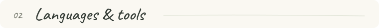
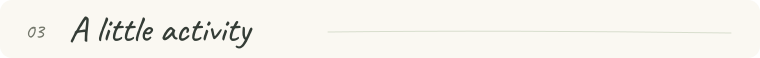

  

  <strong>Mechanical engineering student</strong> &nbsp; · &nbsp; France 
  <em>Open source, audio experiments, and small tools.</em>

  I'm not a developer; I code in my free time. 
  I enjoy figuring out how things work, where <strong>software, hardware, and music</strong> meet.

> **A note on how I code** 
> I write my contributions to other people's repositories myself. Some of my personal projects are vibe-coded with AI, including OSCMidi.

  

#### [OSCMidi](https://github.com/GoulagmanYt/RTP-OSC-Midi-tool)

A Windows tool that brings **RTP-MIDI, local MIDI, OSC, and VST instruments** together.

`Rust` `TypeScript` `Tauri` &nbsp; · &nbsp; [Releases & downloads](https://github.com/GoulagmanYt/RTP-OSC-Midi-tool/releases) 
Personal project · Vibe-coded with AI

#### [Piano LED menu tester](https://github.com/GoulagmanYt/Piano_Led_Visualizer_menulcd_tester)

A small tool to **test and display menus** for Piano LED Visualizer.

`Python` &nbsp; · &nbsp; [Explore the code](https://github.com/GoulagmanYt/Piano_Led_Visualizer_menulcd_tester) 
Personal experiment · AI-assisted

  
Also on my workbench: piano, LEDs, and a Raspberry Pi

  
I also explore <a href="https://github.com/onlaj/Piano-LED-Visualizer">Piano LED Visualizer</a>, which connects a piano to a Raspberry Pi and an LED strip. <a href="https://github.com/GoulagmanYt/Piano-LED-Visualizer">My fork</a> is part of that tinkering.

 

  <a href="https://github.com/GoulagmanYt?tab=repositories">Browse my repositories</a>
  &nbsp; / &nbsp;
  <a href="https://github.com/issues?q=is%3Apr%20author%3AGoulagmanYt%20archived%3Afalse">My pull requests</a>

  

  <strong>Tools I use</strong>  
  <kbd>VS Code</kbd> &nbsp; &nbsp; <kbd>Antigravity</kbd> &nbsp; &nbsp; <kbd>GitHub</kbd>

  

  

  

