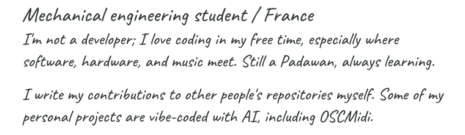
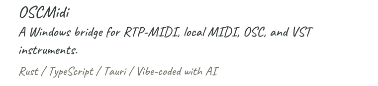
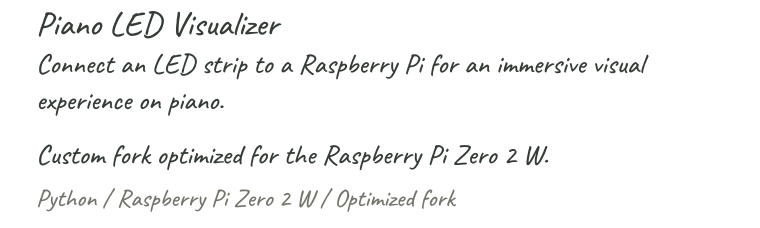
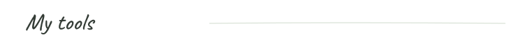

<picture>
  <source media="(prefers-color-scheme: dark)" srcset="assets/name-dark.svg" />
  
</picture>

<picture>
  <source media="(max-width: 600px) and (prefers-color-scheme: dark)" srcset="assets/about-mobile-dark.svg" />
  <source media="(max-width: 600px)" srcset="assets/about-mobile.svg" />
  <source media="(prefers-color-scheme: dark)" srcset="assets/about-dark.svg" />
  
</picture>

<picture>
  <source media="(max-width: 600px) and (prefers-color-scheme: dark)" srcset="assets/heading-projects-mobile-dark.svg" />
  <source media="(max-width: 600px)" srcset="assets/heading-projects-mobile.svg" />
  <source media="(prefers-color-scheme: dark)" srcset="assets/heading-projects-dark.svg" />
  
</picture>

<picture>
  <source media="(max-width: 600px) and (prefers-color-scheme: dark)" srcset="assets/project-osc-mobile-dark.svg" />
  <source media="(max-width: 600px)" srcset="assets/project-osc-mobile.svg" />
  <source media="(prefers-color-scheme: dark)" srcset="assets/project-osc-dark.svg" />
  
</picture>

<picture>
  <source media="(prefers-color-scheme: dark)" srcset="assets/link-downloads-dark.svg" />
  
</picture>

<picture>
  <source media="(max-width: 600px) and (prefers-color-scheme: dark)" srcset="assets/project-piano-mobile-dark.svg" />
  <source media="(max-width: 600px)" srcset="assets/project-piano-mobile.svg" />
  <source media="(prefers-color-scheme: dark)" srcset="assets/project-piano-dark.svg" />
  
</picture>

<picture>
  <source media="(prefers-color-scheme: dark)" srcset="assets/link-tester-dark.svg" />
  
</picture>

<picture>
  <source media="(max-width: 600px) and (prefers-color-scheme: dark)" srcset="assets/heading-tools-mobile-dark.svg" />
  <source media="(max-width: 600px)" srcset="assets/heading-tools-mobile.svg" />
  <source media="(prefers-color-scheme: dark)" srcset="assets/heading-tools-dark.svg" />
  
</picture>

  &emsp;&emsp;
  
  &nbsp; &nbsp;
  
  &nbsp; &nbsp;
  

<picture>
  <source media="(prefers-color-scheme: dark)" srcset="assets/languages-dark.svg" />
  
</picture>

<picture>
  <source media="(prefers-color-scheme: dark)" srcset="assets/stats-dark.svg" />
  
</picture>

<picture>
  <source media="(prefers-color-scheme: dark)" srcset="assets/link-repos-dark.svg" />
  
</picture>
&nbsp; &nbsp;
<picture>
  <source media="(prefers-color-scheme: dark)" srcset="assets/link-prs-dark.svg" />
  
</picture>

